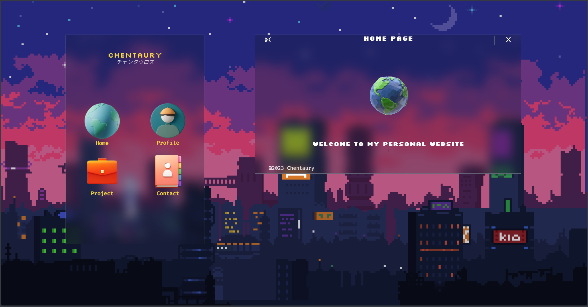
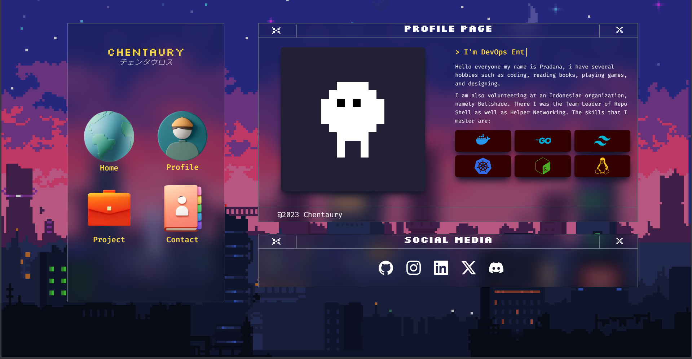
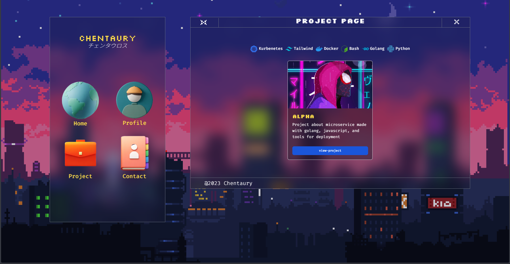
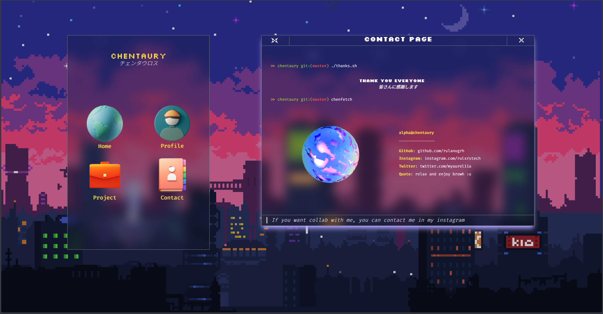

# Namra: Personal Website with Theme Pixel 

This repo containing personal website with theme piexel. However this web, i have been created 3 years ago (2023), this web use `Tailwind CSS` for styling and `Flowbite` for better component used

### Home Page

### Profile Page

### Project Page

### Contact Page

